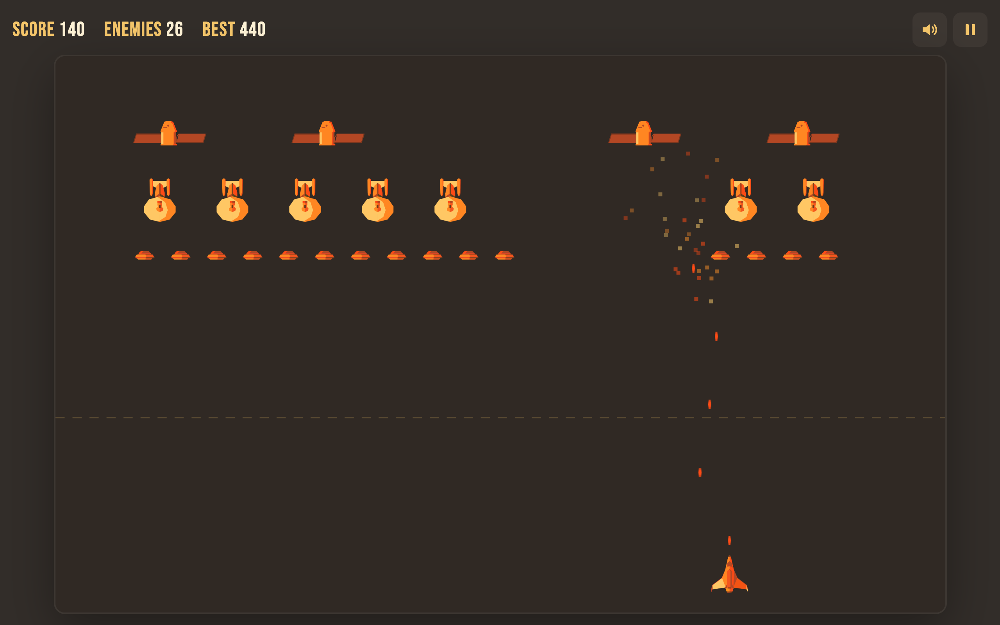

# Space Invaders

A browser shooter with hand-drawn art. Clear the wave before it crosses the line.

**[▶ Play it](https://shb327.github.io/space-invaders/)**



## How to play

| Action | Keyboard | Touch |
| --- | --- | --- |
| Move | <kbd>A</kbd> <kbd>D</kbd> or <kbd>←</kbd> <kbd>→</kbd> | ◀ ▶ buttons |
| Shoot | <kbd>Space</kbd> (hold to keep firing) | Fire button |
| Pause | <kbd>P</kbd> or <kbd>Esc</kbd> | Pause button |
| Sound on/off | <kbd>M</kbd> | Speaker button |

UFOs take 1 hit (10 points), warships 2 (20) and shuttles 3 (30). Every kill makes the wave faster. Clear it in under 60 seconds for a time bonus. Your best score is saved in your browser.

## Tech

- Vanilla JavaScript (ES modules, classes) and the Canvas 2D API
- Fixed-size game world scaled to any screen, with frame-rate independent movement
- Responsive HTML/CSS layout with touch controls
- No dependencies or build step; deployed to GitHub Pages with GitHub Actions

All art was drawn in Photoshop. This started as a university project in 2022.

## Run locally

ES modules need a web server, so opening `index.html` directly won't work:

```bash
python3 -m http.server
```

Then open http://localhost:8000.
